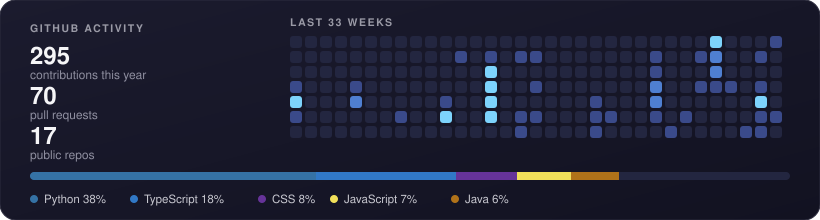
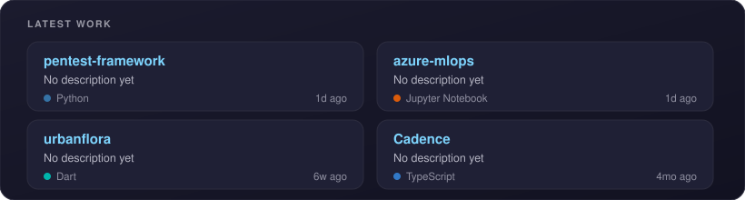
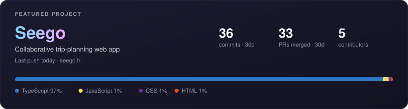

  

  🥐 French student &amp; developer · 🏊 🚴 🏃 triathlete on the side

  

---

### 👋 A bit about me

I've been building websites and mobile apps for about 5 years, through my studies and on real projects. These days I lean towards **DevOps and cloud**: automating the boring stuff, shipping reliably, and keeping things simple enough to maintain.

- 🏗️ Working on **[Seego](https://seego.fr)**, a collaborative trip-planning web app. I'm the DevOps of a team of 5
- 🌐 Building web &amp; mobile apps, and digging into CI/CD, containers and cloud
- 🏊 🚴 🏃 Training for triathlons. Same mindset as code: consistency beats intensity
- 💬 Ask me about pipelines, side projects, or how to fit three sports into one week

### 🛠️ Toolbox

**Web & mobile**

  
  
  
  
  
  
  
  

**Backend & data**

  
  
  
  
  
  

**DevOps & cloud**

  
  
  
  
  
  
  

**Design**

  

### 🚧 Latest work

  

### 🧭 Featured project

  

### 🟢 Live

  

### 📫 Let's talk

  
  
  

The cards above are generated daily by a GitHub Action. The Live badge checks the site in real time.
